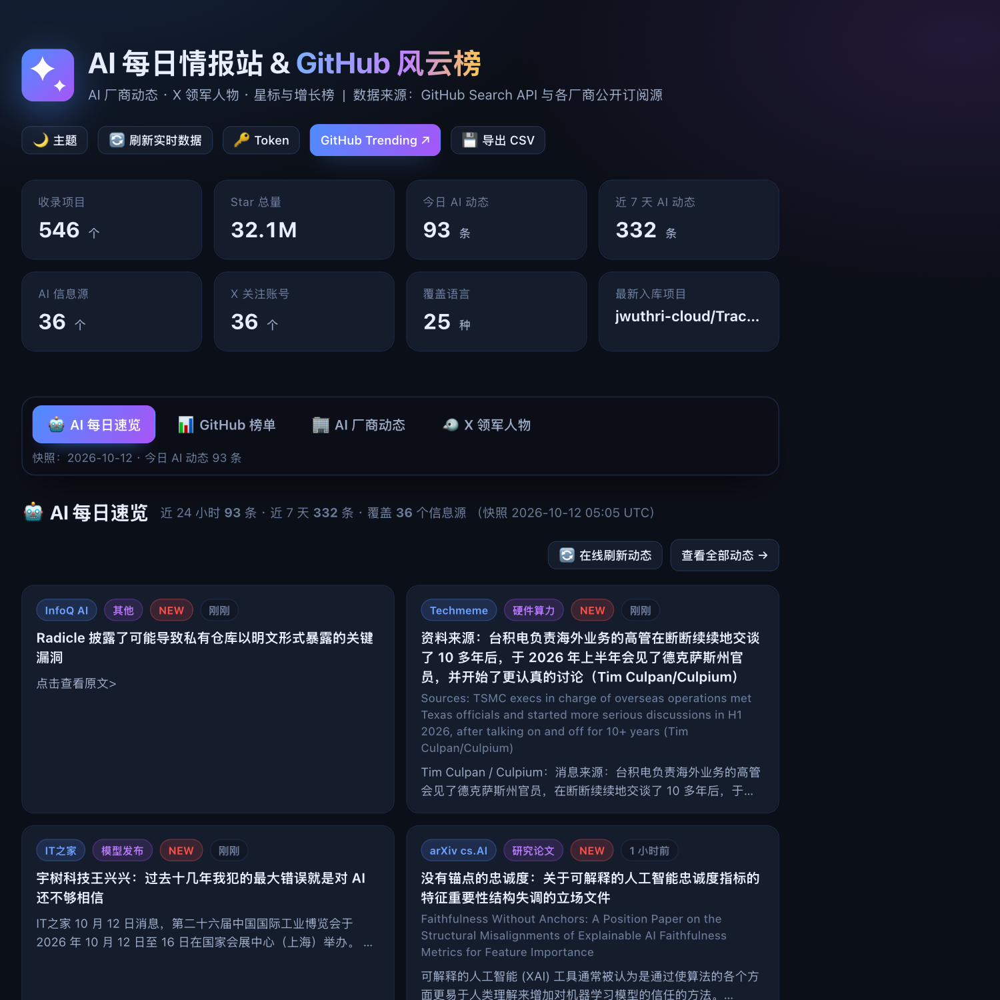
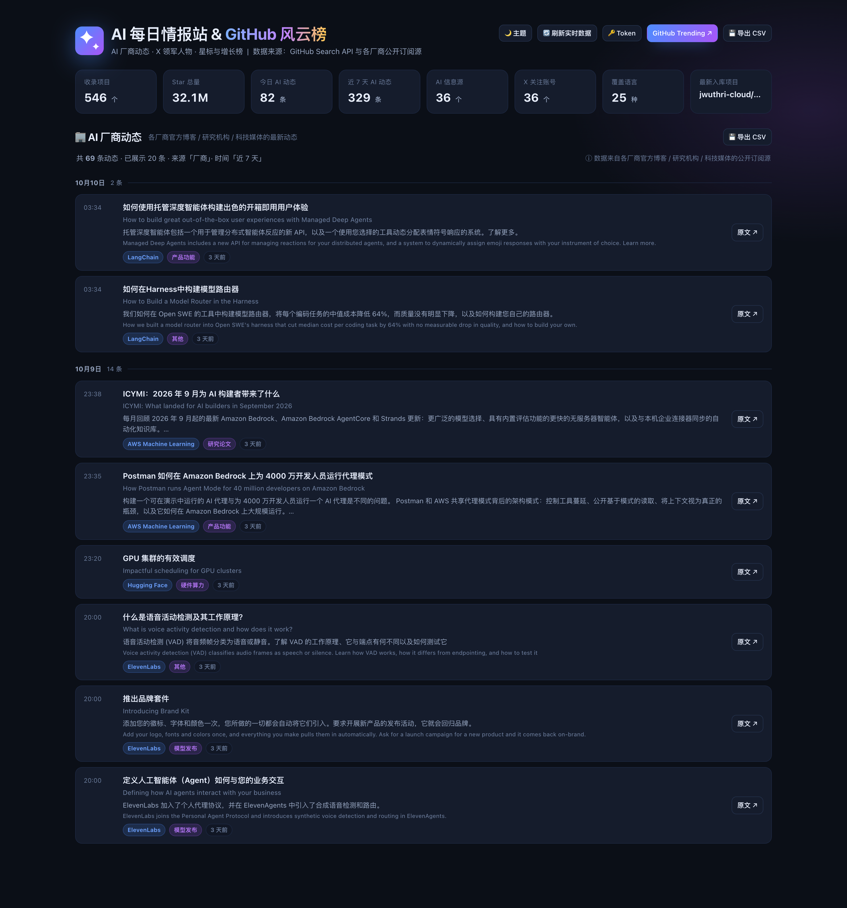
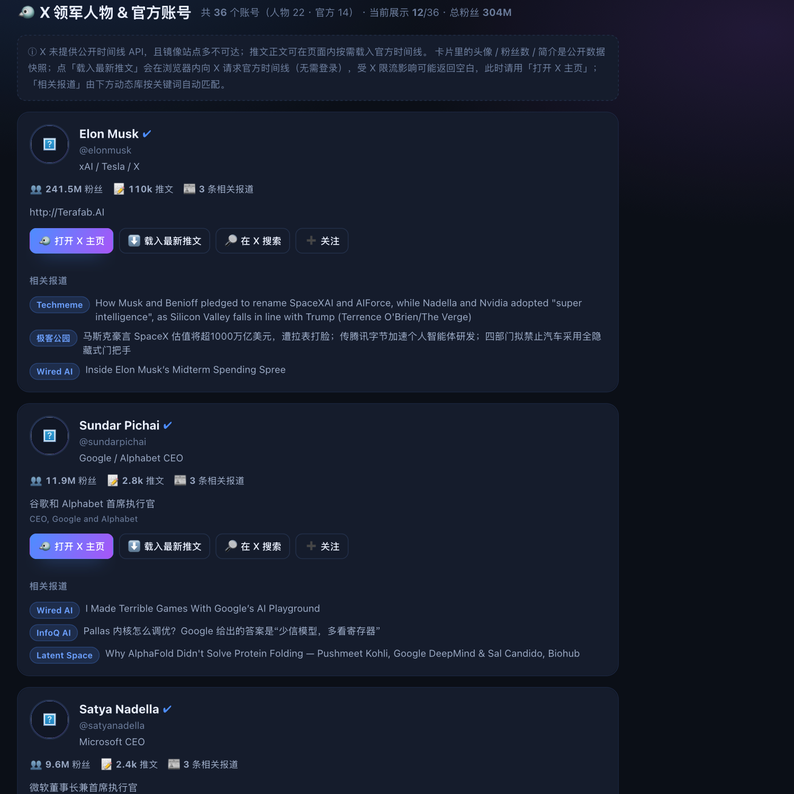
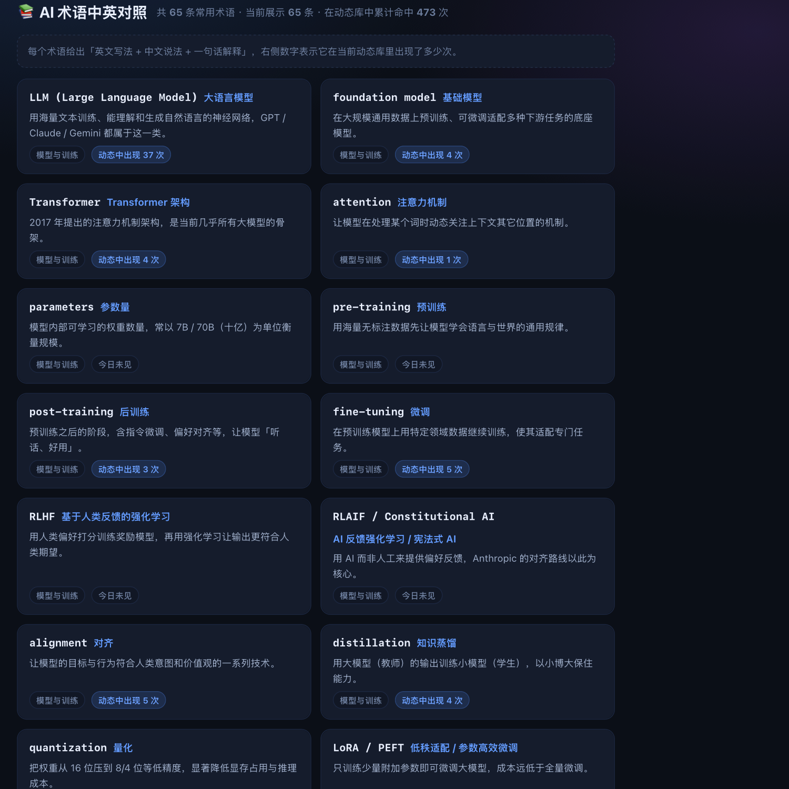

# AI 每日情报站 · GitHub 风云榜 🤖

一个**单文件、可离线打开**的网页：**中英对照显示**（看不懂英文也能读，同时积累专业词汇），每天扫一眼就能了解四件事：

1. **🤖 AI 每日速览** —— 近 24 小时全球 AI 关键动态（厂商官方优先，来源多样化）
2. **🏢 AI 厂商动态** —— 600 条动态聚合自 **39 个** 厂商官方博客 / 研究机构 / 科技媒体 / 中文资讯 / Newsletter，可按来源、类型、时间、关键词筛选
3. **🐦 X 领军人物 & 官方账号** —— 36 个账号（22 位领军人物 + 14 个厂商官方），含粉丝数、简介、一键载入官方时间线、自动匹配的相关报道
4. **📊 GitHub 项目风云榜** —— Star 总榜与增长榜，含详情弹窗、README 摘要、真实 Star 曲线
5. **📚 AI 术语中英对照表** —— 65 条高频术语（英文 + 中文 + 一句话解释），并统计每条术语在当前动态库里出现了多少次

## 直接使用

- **看页面**：双击打开 [index.html](index.html)（数据已内嵌，离线可看）
- **更新数据**：双击 **`更新并打开.command`**，或执行 `./scripts/update_daily.sh`（约 1~2 分钟，自动重建页面）
- **分享/上线**：见下文「分享给别人」——发文件、局域网共享、临时公网链接、或 GitHub Pages 长期托管（含每日自动更新）



> 下面几张截图是某个快照时点的排版示意（数字会随每日更新变化）。







## 仓库里有什么

整个项目都在仓库里，克隆下来即可完整复现（无需任何外部依赖，只用标准库 + Node）：

| 目录 | 内容 |
| --- | --- |
| `index.html` | 构建产物：单文件网页（数据 / 样式 / 脚本 / 图标全内嵌） |
| `web/` | 前端源码：模板、样式、逻辑（改完跑 `build.py` 重新生成 index.html） |
| `scripts/` | 全部流程脚本：抓取、合并、翻译、构建、自测、分享、推送 |
| `data/` | 数据：560→546 个项目、600 条动态、39 份 README、65 条术语、8 份 API 原始返回 |
| `docs/` | 预览图与品牌图 |
| `.github/workflows/` | 每日自动更新 + 发布 Pages 的工作流 |

**唯一没有放进仓库的是 `tools/cloudflared`**（38MB）：那是 Cloudflare 的第三方隧道程序，不是本项目的代码，
`share_public.sh` 首次运行会自动下载到该目录。如果确实需要连它一起提交，把 `.gitignore` 里的 `tools/` 删掉即可。

> 关于仓库体积：每日工作流**默认只发布页面、不把更新后的数据提交回仓库**（否则每天会增加约 9MB 历史，一年膨胀数 GB）。
> 想给仓库留一份最新数据快照时，在 Actions 页面手动运行并勾选 `commit_data`。

## 分享给别人（4 种方式，按省事程度排序）

因为整站是**一个自包含的 `index.html`**（数据、样式、脚本、图标全部内嵌），所以怎么分享都行 —— 不需要对方装任何东西。

### 1️⃣ 直接发文件（最简单，离线可用）

把 `index.html`（约 2.6 MB）通过微信 / 邮件 / 网盘发给对方，双击就能看，**不需要联网**。
唯一差别：在线刷新、头像、Star 曲线、README 在线抓取这些需要联网，离线时自动降级（数据是发文件那一刻的快照）。

### 2️⃣ 同一 WiFi / 公司内网共享

双击 **`局域网共享.command`**（或 `./scripts/share_lan.sh`），脚本会打印一个网址，形如：

```
同事访问：   http://172.21.82.51:8788/     ← 把这个发给他们
```

- 只共享 `index.html` 和 `favicon.svg`，`data/` 原始数据不会暴露（已验证访问 `/data/*.json` 返回 404）
- 首次运行若弹出防火墙询问，选「允许」
- 仅限同一局域网；`Ctrl+C` 停止

### 3️⃣ 临时公网链接（给外网的人看，随时失效）

双击 **`公网链接.command`**（或 `./scripts/share_public.sh`），走 Cloudflare 快速隧道，打印一个 https 网址：

```
公网地址：  https://xxxx-xxxx-xxxx.trycloudflare.com
自检结果：  HTTP 200  ✅ 已确认可被任何人打开
```

- 任何人打开链接就能看，**对方无需安装任何东西**；关掉窗口链接立即失效
- 首次运行会自动下载 cloudflared（约 20 MB）到项目内 `tools/` 目录，之后复用
- 链接是公开的，别拿它分享敏感内容

### 4️⃣ 长期公开（推荐 GitHub Pages，附带每日自动更新）

把项目推到 GitHub 仓库，然后在 **Settings → Pages → Source 选 “GitHub Actions”**。
仓库里已经放好了 `.github/workflows/daily.yml`，它会：

1. 每天北京时间 09:30 自动抓取最新数据（GitHub 榜单用内置 Token，额度比本地高得多）
2. 生成中文对照 → 重建 `index.html` → 跑自测（不通过就不发布）
3. 把数据提交回仓库，并发布到 `https://<你的用户名>.github.io/<仓库名>/`

也支持在 Actions 页面手动点 “Run workflow” 立即更新一次。其他人访问这个网址即可，永远是最新数据。

> 其他等价选择：**Cloudflare Pages**、**Netlify Drop**（把 `index.html` 拖进网页即可）、**Vercel**；
> 国内访问更快的可以用 **Gitee Pages** 或阿里云 OSS / 腾讯云 COS + CDN。只要能放静态文件就行。

## 网站图标与品牌图

浏览器标签页上的图标（favicon）由 `scripts/make_logo.py` 生成，风格与页面主色一致：**渐变圆角方块（#4d8dff → #a855f7）+ 白色星火**。

- 小尺寸单独优化：≤20px 时只保留一颗居中的大星火，避免细节糊成一团；≥24px 显示大小双星火。
- 三种格式全部**内嵌为 data URI**（矢量 SVG + 16/32px PNG + 180px 应用图标），因此双击 `index.html` 离线打开也有图标，不依赖外部文件。
- 同时输出 `favicon.svg` 到项目根目录，方便用 `http://` 访问时直接命中。
- `docs/logo.png` 是品牌横幅（图标 + 站名 + 副标题），`docs/icon.png` 是 512px 大图。

标签页标题已缩短为 **「AI 每日情报站 · GitHub 榜」**，避免像之前那样被截断成 “AI 每日情报站 · 厂商…”。

重新生成图标（改了配色或形状后）：

```bash
/Users/june/.dsh/dsh-runtimes/dsh-primary-runtime/dependencies/python/bin/python3 scripts/make_logo.py
python3 scripts/build.py
```

> 图标是浏览器强缓存的资源：换过图标后如果标签页还显示旧图标或地球占位符，**硬刷新（⌘⇧R）** 或关掉标签页重开即可。

## 中英对照（默认开启）

页面右上角有 **「中 / 中英 / EN」** 三档切换，选择会记在本机，默认是**中英对照**：

```
如何使用托管深度智能体构建出色的开箱即用用户体验      ← 中文（主）
How to build great out-of-the-box user experiences with Managed Deep Agents   ← 英文原文（副，便于学词汇）
```

覆盖范围：AI 动态的标题与摘要、GitHub 项目描述、X 账号简介。

- **翻译怎么来的**：构建时通过 Chrome 内置翻译同款公开端点（`clients5.google.com/translate_a/t`，免密钥、支持一次请求多条）批量翻译，质量稳定；
  译文写入 `data/translate_cache.json` 缓存，所以**每天更新只会翻译新增内容**（首次全量约 40 秒，之后通常 1~3 秒）。
- **术语修正层**：机器翻译在 AI 领域有不少固定误译，脚本会统一纠正，例如
  `多式联运 → 多模态`、`变压器 → Transformer`、`量子化 → 量化`、`线束 → Harness`、`托管深度代理 → 托管深度智能体`、
  `令牌 → Token`，并给 `RLHF / RAG / CoT / MoE` 等补上英文缩写，方便对照记忆。
- **README 太长不翻**：详情弹窗里的 README 译文改用**浏览器端上翻译**（Chrome 138+ 内置 Translator API，免费无限、不上传内容）：
  点「🌐 这段翻成中文」即可，再点一次切回英文；不支持该 API 的浏览器会提示改用右键「翻译成中文」或 Google 翻译链接。
- **术语表**：`data/glossary.json` 里是我整理的 65 条常用术语（模型与训练 / 推理与应用 / 智能体 / 评测与安全 / 算力与工程 / 商业与生态），
  卡片右侧的「动态中出现 N 次」由页面按当前数据实时统计，方便顺着真实语境记词。

## 板块说明

### 🤖 AI 每日速览
从动态库里按"厂商官方优先、同一来源先只取 1 条、再按时间排序"选出 9 条，保证一眼看到的是**不同厂商**的最新动作，而不是某一家的刷屏。

### 🏢 AI 厂商动态
- **筛选**：分组（厂商官方 / 研究机构 / 科技媒体 / 中文资讯 / Newsletter / 社区）、具体来源、类型（模型发布 / 开源 / 研究论文 / 产品功能 / 政策安全 / 商业资本 / 硬件算力）、时间窗（24 小时 / 3 天 / 7 天 / 30 天 / 全部）、关键词搜索
- **展示**：按日期分组的时间线，含来源徽标、类型徽标、摘要、原文跳转
- **导出**：一键把当前筛选结果导出 CSV
- **在线刷新**：🔄 按钮会通过 CORS 代理重新拉取 8 个主要厂商源，失败时自动保留本地快照

当前收录的源（39 个）：

| 分组 | 来源 |
| --- | --- |
| 厂商官方 | OpenAI、Anthropic、DeepSeek、Google AI、Google Research、Microsoft AI、NVIDIA、Hugging Face、阿里 Qwen、Together AI、ElevenLabs、Ollama、AWS ML、MiniMax、LangChain |
| 研究机构 | arXiv cs.AI、Berkeley BAIR |
| 科技媒体 | TechCrunch AI、The Verge AI、MIT Tech Review、Techmeme、Ars Technica AI、Wired AI、ZDNet AI、The Decoder、MarkTechPost |
| 中文资讯 | 量子位、InfoQ AI、IT之家、极客公园、雷峰网、钛媒体（后四者只保留标题含 AI 关键词的条目） |
| 社区 | Hacker News (AI)、Simon Willison |
| Newsletter | Import AI、Interconnects、Latent Space、One Useful Thing、Smol AI News |

### 🐦 X 领军人物 & 官方账号

**关于 X 的获取方式（重要）**：X 官方 API 需付费鉴权，nitter / rsshub 等镜像站点多已失效或不可达，syndication 时间线接口按 IP 限流。
因此本页采取"**资料快照 + 浏览器端按需载入**"的组合：

| 内容 | 获取方式 | 是否可靠 |
| --- | --- | --- |
| 头像 / 粉丝数 / 简介 / 认证 | `api.fxtwitter.com/<handle>` 公开接口，抓取时快照进页面 | ✅ 每次更新都会刷新 |
| 推文正文 | 点「⬇️ 载入最新推文」后，在**你的浏览器**里请求 X 官方嵌入组件（`platform.twitter.com/widgets.js`，无需登录） | ⚠️ 受 X 限流影响，可能返回空白 |
| 备用方案 | 官方组件失败时自动改用 `syndication.twitter.com` 备用时间线 | ⚠️ 同上 |
| 保底入口 | 「🐦 打开 X 主页」「🔎 在 X 搜索」「➕ 关注」 | ✅ 永远可用 |
| 相关报道 | 用人物/机构关键词在动态库里匹配，**标题命中优先** | ✅ 离线可用，30/36 个账号能匹配到 |

也就是：**不依赖 X 也能看到"这个人/这家公司最近发生了什么"**（通过相关报道），想要一手推文再点一下按钮。

推文快照的设计原则是**宁可没有、也不给死链**：解析内嵌 JSON 时要求"作者必须是本人 + ID 必须是 15~20 位推文 ID"；
如果载荷里没有作者信息，或走了正则兜底路径，则每条推文都要先向公开接口核对存在性与归属，核对不通过就丢弃。
`scripts/test_tweet_parse.py` 用 15 项断言把这条规则固定住（早期版本曾出现"正文是真的、ID 却是用户 ID"的问题）。

## 数据来源与口径

- GitHub 榜单：GitHub Search API（8 组查询），去重后 560 个项目；README 摘要抓自 `raw.githubusercontent.com`。
- AI 动态：各源公开 RSS/Atom 订阅源 + Anthropic / DeepSeek / MiniMax / LangChain 的 HTML 解析。
- “**日均增星**” = Star 总数 ÷ 项目创建天数（页面打开时按当前时刻重算，因此“近 7 天”时间窗始终精确）。
- GitHub **没有**官方增速接口，增速榜为近似估算；详情页内嵌 [star-history.com](https://star-history.com) 真实曲线可交叉验证。
- 动态去重规则：URL 归一化（去掉 utm 等参数）+ 标题指纹；只保留 **75 天内**的条目，每源最多 40 条，总量上限 600 条。
- 有些厂商长期不更新博客（例如 Qwen 的 GitHub Pages），脚本会保留其最新 1~2 条并标注「较早发布」，避免板块空白。

## 目录结构

```
github-trends/
├── index.html                 # ✅ 交付物：自包含网页（数据 + CSS + JS 全内嵌）
├── LICENSE                    # MIT 协议
├── .gitignore                 # 排除 tools/（外部二进制）与 data/raw/（可重新抓取）
├── favicon.svg                # 站点图标（矢量，http 访问时直接命中）
├── 更新并打开.command          # 双击更新数据并用浏览器打开
├── 局域网共享.command          # 双击在局域网内共享（同一 WiFi 的同事可访问）
├── 公网链接.command            # 双击生成临时公网 https 链接
├── .github/workflows/daily.yml # GitHub Actions：每日自动更新 + 发布 Pages
├── tools/                     # cloudflared 二进制缓存（首次分享时自动下载）
├── README.md
├── data/
│   ├── repos.json             # 560 个 GitHub 项目（含派生指标）
│   ├── readmes.json           # 557 份 README 原文
│   ├── ai_news.json           # AI 动态 + 各源抓取状态（含 title_zh / summary_zh 中译）
│   ├── glossary.json          # 65 条 AI 术语中英对照（人工整理）
│   ├── translate_cache.json   # 翻译缓存（每日更新只翻新增内容）
│   ├── x_leaders.json         # 36 个 X 账号资料 + 推文快照（若有）
│   └── raw/*.json             # GitHub Search API 原始返回
├── web/
│   ├── index.template.html    # 页面骨架（__CSS__ / __DATA__ / __JS__ 注入点）
│   ├── styles.css             # 全部样式（亮暗主题、响应式）
│   ├── favicon.svg            # 图标矢量源文件（构建时内嵌进 HTML）
│   ├── icon-16/32/180/512.png # 各尺寸 PNG 图标
│   └── app.js                 # 全部前端逻辑（榜单 / 动态 / 人物 / 弹窗 / Markdown / 在线刷新）
├── docs/                      # 预览图
└── scripts/
    ├── update_daily.sh        # 一键每日更新（AI 动态 + X + 翻译 + 构建 + 自测）
    ├── share_lan.sh           # 局域网共享（只暴露 index.html + favicon.svg）
    ├── share_public.sh        # Cloudflare 隧道生成临时公网链接
    ├── collect.sh             # GitHub Search API 抓取（自带限速）
    ├── merge.py               # 合并去重 + 计算增速指标
    ├── fetch_readmes.py       # 并发抓取 README
    ├── fetch_ai_news.py       # 39 个资讯源抓取 + 分类 + 去重
    ├── fetch_x.py             # X 账号资料 + 推文快照尝试
    ├── translate.py           # 翻译模块（Google 端点 + MyMemory 兜底 + 术语修正 + 缓存）
    ├── translate_data.py      # 给三个数据文件回填中文字段
    ├── build.py               # 生成自包含 index.html
    ├── smoke.js               # 99 项网页运行时自测（DOM 模拟 + 冻结时钟）
    ├── test_tweet_parse.py    # 15 项推文解析自测（防止 ID 错配成死链）
    ├── make_logo.py           # 生成 favicon / 各尺寸图标 / 品牌横幅（需 Pillow + 系统字体）
    ├── snapshot.js            # 导出静态预览页（用于排版目检）
    └── probe_sources*.py      # 数据源可用性探测（保留备查）
```

## 常用命令

```bash
# 每天更新（AI 动态 + X 资料 + 重建 + 自测），约 1~2 分钟
./scripts/update_daily.sh

# 连 GitHub 榜单一起刷新（较慢，会消耗 GitHub 搜索额度）
WITH_GITHUB=1 ./scripts/update_daily.sh

# 只补翻译（走缓存，很快；改了术语修正表后重跑即可）
python3 scripts/translate_data.py

# 只重建页面（改完 web/ 里的源码后）
python3 scripts/build.py

# 自测（99 项断言：榜单 / 筛选复算 / 弹窗 / README 渲染 / 动态 / 人物 / 中英对照 / 术语表 / 实时刷新）
node scripts/smoke.js

# 推文解析自测（15 项断言：作者归属、ID 校验、拿不准就丢弃）
python3 scripts/test_tweet_parse.py

# 生成排版预览页（供不支持 JS 的渲染器检查）
node scripts/snapshot.js /tmp
```

### 每天自动更新（可选）

```bash
# 每天 9:00 自动更新，日志写到 /tmp/ai-daily.log
crontab -e
0 9 * * * cd /Users/june/Documents/deepseek-harness/default-workspace/github-trends && ./scripts/update_daily.sh >> /tmp/ai-daily.log 2>&1
```

## 已知限制

1. **X 推文正文**：如上一节所述，服务端抓不到（API 收费 / 镜像不可达 / 限流），页面用"浏览器端按需载入 + 相关报道"兜底。
2. **Meta AI、xAI、Mistral、Stability、Perplexity 等**：其博客/新闻页在抓取环境下返回 400/403 或无可解析订阅源，暂未覆盖；它们的最新消息通常会被 TechCrunch / The Verge / Techmeme 等媒体源带到动态流里。
3. **arXiv cs.AI** 条目较多，默认视图只显示「厂商官方」分组，需要看论文时切到「🔬 研究机构」。
